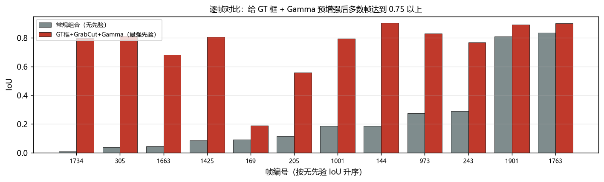

# 低照度 RGB-T 图像分割

李嘉怡 · 人工智能 2402 · 202456435 · 图像处理课程大作业

## 这个作业在做什么

低照度室内场景里，可见光图像基本全黑，待分割的物体只占画面 0.3%~6%。我想知道传统流水线
在这种数据上到底能做到什么程度，所以把它拆成四段，每段实现几个可替换的算子，然后穷举组合：

- 增强：Gamma、全局直方图均衡、CLAHE、多尺度 Retinex、灰度世界白平衡
- 融合：只用 RGB、只用热红外、加权平均、PCA、拉普拉斯金字塔、取最大值
- 分割：Otsu、三角形阈值、自适应阈值、K-means、区域生长、GrabCut
- 后处理：形态学顶帽（针对小目标）、开闭运算、连通域面积过滤

主网格是 6 增强 × 4 融合 × 6 分割 × 12 帧，跑完 1152 次。

## 结果

| 条件 | 用到的先验 | IoU |
|:--|:--|--:|
| 不加先验的最佳组合（Gamma + 仅热红外 + 自适应阈值） | — | 0.247 |
| 面积先验（阈值取到目标真实面积） | 面积 | 0.212 |
| 单阈值最优上界（100 档阈值取最好） | 阈值 | 0.236 |
| 三算子投票集成 | — | 0.223 |
| 真值框 + GrabCut | 位置 | 0.463 |
| 真值框 + Gamma + GrabCut | 位置 + 预处理 | 0.744 |

逐帧结果（灰：无先验；红：给真值框 + Gamma）：



## 几点观察

1. 加增强对 Otsu 这类全局阈值是负作用（0.064 → 0.035），因为阈值法依赖直方图的绝对形状，
   增强恰好把形状改了。但同一个 Gamma 用在 GrabCut 上却是正作用（0.463 → 0.744），
   因为 GMM 只需要框内的灰度差拉开。所以"增强有没有用"取决于下游是谁。
2. 知道目标多大反而更差（0.212），把阈值调到理论最优也只有 0.236。
   真正稀缺的是位置——给个真值框分数立刻翻倍。
3. 只用热红外（0.074）比只用 RGB（0.019）好 4 倍。把可见光压暗到 0.1 倍后，
   依赖 RGB 的融合方法反而从 0.162 升到 0.239，说明这个场景里可见光基本是干扰。

## 怎么跑

```bash
pip install -r requirements.txt

# 单张图
python demo.py --rgb data/cases/1001/RGB.png --thermal data/cases/1001/热红外.png

# 全部实验（CPU 约 2 分钟）
python scripts/run_experiments.py
python scripts/make_figures.py

# 单元测试
python tests/test_core.py
```

`run_experiments.py` 会写出四个 csv：`grid.csv`（1152 行）、`oracle.csv`（阈值上界）、
`strong.csv`（先验阶梯）、`degrade.csv`（压暗实验）。

## 踩过的坑

- 拉普拉斯金字塔融合我一开始返回的是二维灰度图，`to_gray` 里又按 `f[..., 0]` 取通道，
  结果拿到形状 `(1, 480)`，和 GT 相加时直接 dimension 报错。后来在 `fuse()` 里统一转成三通道。
- GrabCut 在 480×640 上单帧要 800 多毫秒，12 帧 × 96 组跑不动，改成半分辨率求解再上采样，
  降到 170 ms 左右。
- 指标一开始想加 S-measure，自己写的简化版算出来 IoU 只有 0.14 的组合居然有 0.76，
  明显不对，查了半天也没能对齐官方实现，最后干脆删掉，只留 IoU / Fβ / MAE 三个。

## 数据说明

`data/cases/` 里的 12 组帧（可见光、热红外、真值掩码）来自公开的多模态分割基准 VDT-2048，
只用于课程实验。仓库里没有预训练权重，也没有第三方模型代码。
